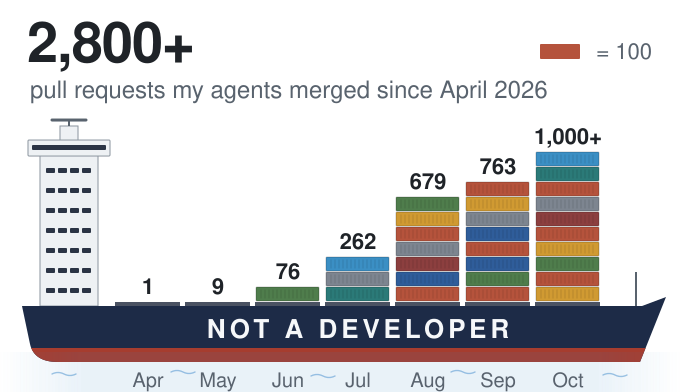

<picture>
  <source media="(prefers-color-scheme: dark)" srcset="assets/ship-dark.svg">
  
</picture>

I decide what to build. AI agents write the code, and other agents review it.

Most of it is for freight work and stays private. The public tools are below.

The agents run on a Mac mini with no screen: Claude, Codex and Grok in T3 Code, at the same time. Most days I give them work from my phone.

I post about building with agents on [X](https://x.com/naicolas) and about freight on [LinkedIn](https://www.linkedin.com/in/nicolasmonterog/).
